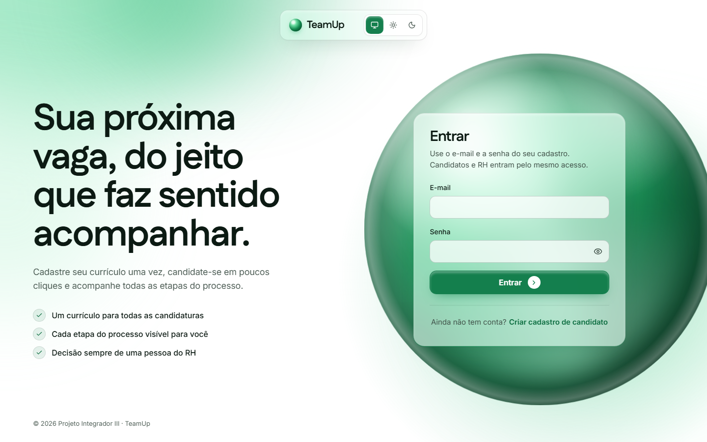
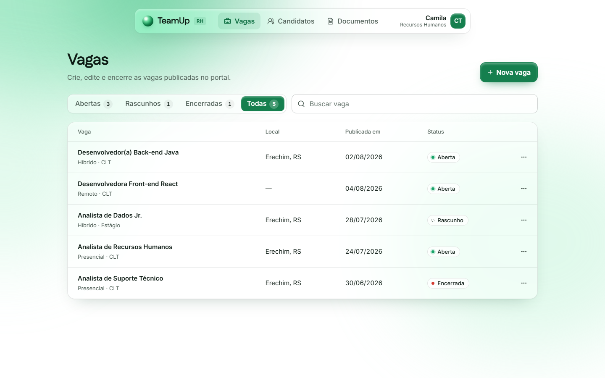
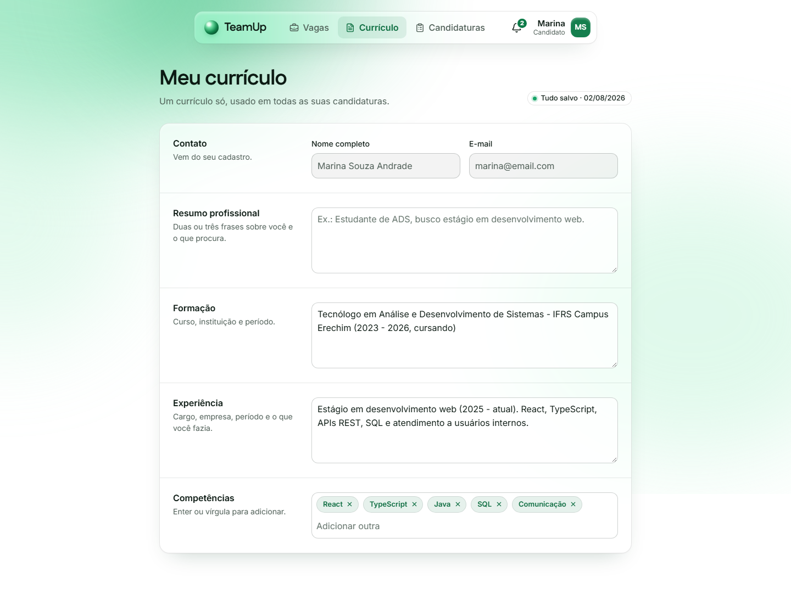
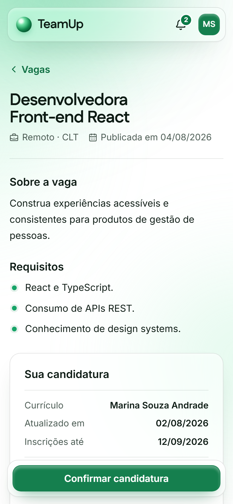
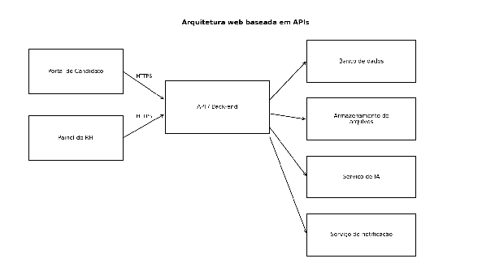

# TeamUp: seleção e recrutamento com triagem de currículos por IA

[](https://github.com/MarcosMilezarek/ProjetoIntegrador-ADS2026/actions/workflows/backend-ci.yml)

**Demo:** https://upteam.duckdns.org/

Projeto Integrador (TCC) do curso de Análise e Desenvolvimento de Sistemas do IFRS Campus Erechim.

## O problema

Num RH pequeno, poucas pessoas publicam as vagas, leem cada currículo, chamam para entrevista e cobram os documentos de admissão. O objetivo do projeto é reduzir o tempo desse processo seletivo, começando pela triagem de currículos.

O TeamUp reúne esse processo num só sistema: o candidato mantém um currículo e se candidata às vagas, e o RH acompanha cada candidatura até a contratação. A cada nova candidatura, um modelo de linguagem compara o currículo com os requisitos da vaga e sugere uma nota de aderência com pontos positivos e negativos. É só uma recomendação: quem muda a etapa do candidato é sempre uma pessoa do RH.

## Funcionalidades

### Candidato

- Cria a própria conta e entra com e-mail e senha.
- Cadastra e edita o currículo: resumo, formação, experiências, competências e certificações, além do PDF do currículo.
- Consulta as vagas abertas e se candidata.
- Acompanha a etapa de cada candidatura: inscrito, em análise, entrevista, aprovado, reprovado, contratado ou cancelado.
- Confirma presença na entrevista agendada pelo RH.
- Envia os documentos de contratação em PDF ou DOCX e vê se cada um foi aprovado ou recusado.
- Recebe notificações em tempo real.

### RH

- Cria, edita, salva como rascunho e encerra vagas, com requisitos separados em obrigatórios, desejáveis e diferenciais.
- Vê os inscritos de cada vaga com a nota de aderência e os pontos positivos e negativos gerados pela IA.
- Lê o currículo e baixa o PDF de cada candidato.
- Muda a etapa da candidatura e agenda entrevistas; a agenda reúne as entrevistas marcadas.
- Aprova ou recusa os documentos enviados.
- Registra a contratação do candidato aprovado, depois que todos os documentos obrigatórios estiverem aprovados. O contratado passa para a lista de funcionários, onde pode ser inativado.
- Recebe notificações em tempo real.

O perfil **administrador** tem as mesmas permissões do RH e, além disso, gerencia as contas de usuário (cadastro de RH, edição e exclusão).

Os requisitos estão em [modelagem/requisitos-funcionais.md](modelagem/requisitos-funcionais.md). Dois deles ainda não foram implementados: RF03 (recuperar senha) e RF16 (relatórios).

## Telas

Capturas com dados de demonstração.

| Login | Vagas do RH |
| --- | --- |
|  |  |

| Currículo do candidato | Detalhe da vaga no celular |
| --- | --- |
|  |  |

## Arquitetura



- **Frontend:** aplicação React de página única com o Portal do Candidato e o Painel do RH. Consome a API REST com o token JWT no cabeçalho `Authorization`.
- **Backend:** monólito modular em Spring Boot, organizado por domínio (`auth`, `usuario`, `vaga`, `curriculo`, `candidatura`, `documento`, `notificacao`, `funcionario`, `analise`), cada um com controller, service, repository, entidades e DTOs. A API responde em `/api`.
- **Banco:** MySQL, com o schema versionado pelo Flyway.
- **Arquivos:** currículos e documentos ficam em disco, fora do repositório e do banco.
- **IA:** a triagem chama a API da OpenRouter de forma assíncrona.
- **Notificações:** enviadas por Server-Sent Events e gravadas no banco.

A documentação completa está em [modelagem/](modelagem/): [arquitetura](modelagem/arquitetura.md), [casos de uso](modelagem/casos-de-uso.md), [regras de negócio](modelagem/regras-de-negocio.md), [diagrama de classes](modelagem/diagrama-de-classes.md), [diagramas de sequência](modelagem/diagrama-de-sequencia.md), [diagramas de estados](modelagem/diagrama-de-estados.md) e [modelo de dados](modelagem/modelo-de-dados.md).

## Stack

| Camada | Tecnologias |
| --- | --- |
| Backend | Java 21, Spring Boot 4.1.0 (Spring MVC, Spring Data JPA, Bean Validation), Spring Security 7.1 com OAuth2 Resource Server (JWT HS256 via Nimbus), BCrypt, Hibernate 7.4, Flyway 12.4, MapStruct 1.6.3, Lombok, springdoc-openapi 3.2.0 |
| Banco | MySQL (H2 em memória nos testes) |
| Frontend | React 19.2, TypeScript 6.0, Vite 8.2, Tailwind CSS 4.3, shadcn/ui (Radix UI), lucide-react |
| Testes | JUnit 6, Mockito 5, Spring MockMvc, H2 |
| CI | GitHub Actions |

## Decisões técnicas

- **JWT stateless com segredo obrigatório.** O token carrega o id e o perfil do usuário, e não há sessão no servidor. `JWT_SECRET` não tem valor padrão: sem ela, ou com menos de 32 caracteres, a aplicação não sobe.
- **Permissão em duas camadas.** O `SegurancaConfig` define o que cada perfil pode acessar. Os services conferem a propriedade, por exemplo, que o candidato só vê o próprio currículo.
- **Flyway com `ddl-auto=none`.** O schema muda só por migração versionada (9 até agora). O Hibernate não cria nem altera tabelas.
- **`open-in-view=false`.** A sessão do JPA não fica aberta durante a serialização da resposta. Os dados são carregados dentro das transações dos services.
- **Triagem via OpenRouter com saída JSON validada.** O modelo responde num esquema JSON estrito, e o backend ainda confere a nota (0 a 100) e as listas de pontos. Resposta inválida vira análise com falha e nunca é gravada como resultado.
- **IA fora do caminho da candidatura.** A análise roda em outra thread depois do commit, então a candidatura não espera nem falha por causa da IA. Nome, e-mail, telefone, data de nascimento, sexo e cidade do candidato não são enviados ao modelo.
- **Upload fora do repositório.** Os arquivos vão para `APP_UPLOAD_DIR` com nome gerado por UUID, limite de 5 MB e conferência da assinatura do arquivo (PDF ou DOCX). O download sempre passa pela API, que confere a permissão.

## Como rodar

Pré-requisitos: JDK 21, Node.js 20.19 ou 22.12 em diante e MySQL.

### Variáveis de ambiente do backend

Os valores abaixo são exemplos.

| Variável | Obrigatória | Exemplo | Para que serve |
| --- | --- | --- | --- |
| `JWT_SECRET` | sim | `gere-com-openssl-rand-base64-48` | Segredo de assinatura do JWT, com no mínimo 32 caracteres. Gere com `openssl rand -base64 48`. |
| `DB_HOST` | não | `localhost` | Host do MySQL (padrão `localhost`). |
| `DB_PORT` | não | `3306` | Porta do MySQL (padrão `3306`). |
| `DB_NAME` | não | `selecao_rh` | Nome do banco (padrão `selecao_rh`). |
| `DB_USER` | não | `selecao_app` | Usuário do banco (padrão `root`). |
| `DB_PASSWORD` | não | `senha-do-banco` | Senha do banco (padrão vazia). |
| `CORS_ALLOWED_ORIGINS` | não | `http://localhost:5173` | Origens liberadas para o frontend (padrão `http://localhost:5173` e `http://127.0.0.1:5173`). |
| `APP_UPLOAD_DIR` | não | `./uploads` | Pasta dos arquivos enviados (padrão `./uploads`). |
| `OPENROUTER_API_KEY` | não | `sua-chave-openrouter` | Chave da OpenRouter (`app.openrouter.api-key`). Sem ela, a análise fica com falha e o resto do sistema funciona normalmente. |
| `OPENROUTER_MODEL` | não | `fornecedor/nome-do-modelo` | Modelo usado na triagem (`app.openrouter.model`). |
| `SPRINGDOC_ENABLED` | não | `true` | Liga ou desliga o Swagger UI (padrão `true`). |

Também dá para usar um arquivo `backend/src/main/resources/application-local.properties`, que não é versionado. O modelo está em [application-local.properties.example](backend/src/main/resources/application-local.properties.example).

### Banco de dados

Crie um banco vazio. As tabelas são criadas pelo Flyway quando o backend sobe.

```sql
CREATE DATABASE selecao_rh CHARACTER SET utf8mb4 COLLATE utf8mb4_unicode_ci;
```

### Backend

```bash
cd backend
export JWT_SECRET="$(openssl rand -base64 48)"
export DB_USER=selecao_app DB_PASSWORD=senha-do-banco
./mvnw spring-boot:run
```

No Windows, use `mvnw.cmd spring-boot:run`. A API sobe em `http://localhost:8080/api`.

### Frontend

```bash
cd frontend
npm ci
echo "VITE_API_URL=http://localhost:8080/api" > .env.development.local
npm run dev
```

O frontend abre em `http://localhost:5173`. Sem o `.env.development.local`, o servidor do Vite repassa as chamadas de `/api` para a demo em https://upteam.duckdns.org, conforme o [vite.config.ts](frontend/vite.config.ts).

### Dados de teste (opcional)

Com o backend já iniciado uma vez (para o Flyway criar as tabelas):

```bash
mysql --default-character-set=utf8mb4 -u selecao_app -p selecao_rh < database/seed.sql
APP_UPLOAD_DIR=./backend/uploads bash database/seed-arquivos.sh
```

O seed cria um administrador, três usuários de RH, 30 candidatos, 18 vagas e candidaturas em todas as etapas. Todos os e-mails terminam em `@exemplo.test` (por exemplo, `admin@exemplo.test` e `rita.rh@exemplo.test`), e a senha de todos é `senha123`. O segundo comando cria os PDFs de exemplo que o seed referencia; sem eles, o download desses arquivos responde 404. Mais detalhes em [database/README.md](database/README.md).

O seed ainda grava os requisitos das vagas só na coluna antiga `requisitos`. Desde a migração V9, a aplicação lê `requisitos_obrigatorios`, `requisitos_desejaveis` e `requisitos_diferenciais`, então as vagas do seed aparecem sem requisitos num banco novo.

## Testes

```bash
cd backend
./mvnw test
```

A suíte tem testes unitários dos services (JUnit e Mockito), testes dos controllers com `@WebMvcTest` e testes de integração com `@SpringBootTest` e MockMvc sobre H2 em memória. Os testes de integração cobrem login, regras de acesso por perfil e propriedade, erros padronizados e a documentação da API. O GitHub Actions roda a suíte a cada push ou pull request na `main` que altere o backend.

## Documentação da API

Com o backend rodando, o Swagger UI fica em http://localhost:8080/api/swagger-ui.html, e a especificação OpenAPI em http://localhost:8080/api/v3/api-docs.

Para testar as rotas protegidas, chame `POST /auth/login`, copie o `token` da resposta e informe-o no botão **Authorize**.

## Estrutura do repositório

```
backend/     API em Spring Boot (código, migrações do Flyway e testes)
frontend/    aplicação React
database/    schema inicial, seed e script dos PDFs de exemplo
modelagem/   requisitos, regras de negócio, diagramas UML e ER
docs/        imagens usadas neste README
```

## Autor

Marcos Alexandre Milezarek, estudante de Análise e Desenvolvimento de Sistemas no IFRS Campus Erechim.

[LinkedIn](https://www.linkedin.com/in/marcosmilezarek/)
